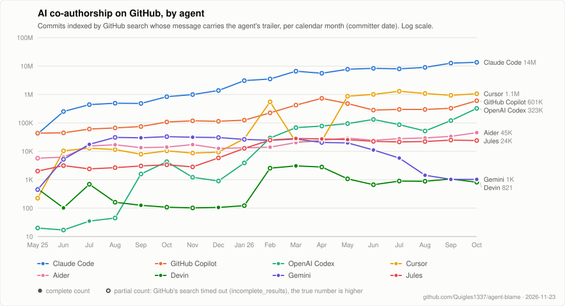

# AI co-authorship on GitHub over time

Generated 2026-11-23 by [`scripts/trends.mjs`](../scripts/trends.mjs); refreshed weekly by [`trends.yml`](../.github/workflows/trends.yml). Raw numbers in [`trends.json`](trends.json).

## Indexed commits per month

Commits indexed by GitHub search whose message matches each agent's query (below), by committer date. † marks a partial count: GitHub's search timed out before scanning everything (`incomplete_results: true`), so the true number is higher by an unknown factor.

| Month | Claude Code | GitHub Copilot | OpenAI Codex | Cursor | Aider | Devin | Gemini | Jules |
| --- | ---: | ---: | ---: | ---: | ---: | ---: | ---: | ---: |
| 2025-05 | 41,058† | 43,563† | 20† | 224† | 5,704† | 479† | 450† | 2,017† |
| 2025-06 | 252,061† | 44,891† | 17† | 10,429† | 6,236 | 102 | 5,247† | 3,151† |
| 2025-07 | 439,133† | 60,728† | 35 | 12,880† | 15,392 | 693† | 17,569 | 2,408† |
| 2025-08 | 492,558† | 66,531† | 45† | 11,512† | 16,981 | 161† | 30,872† | 2,662† |
| 2025-09 | 483,326† | 74,675† | 1,589† | 7,916† | 13,487 | 126 | 29,908 | 3,061† |
| 2025-10 | 836,993† | 107,546† | 4,304† | 10,385† | 14,056 | 108† | 32,802† | 3,361† |
| 2025-11 | 993,235† | 118,354† | 1,219† | 8,684† | 17,235 | 102† | 31,393 | 2,830† |
| 2025-12 | 1,378,456† | 114,132† | 901† | 9,383† | 12,651 | 106 | 30,512† | 5,880† |
| 2026-01 | 3,074,976† | 125,077† | 3,894† | 27,856† | 13,288 | 122† | 26,217† | 12,716† |
| 2026-02 | 3,516,111† | 225,362† | 29,408† | 551,455† | 13,986 | 2,550† | 24,393 | 24,791† |
| 2026-03 | 6,596,338† | 422,990† | 68,022† | 21,152† | 20,293 | 3,073 | 27,105† | 28,387 |
| 2026-04 | 5,596,036† | 732,018† | 77,411† | 23,217† | 24,394 | 2,811† | 20,495† | 27,274 |
| 2026-05 | 7,725,836† | 479,246† | 94,869† | 867,671† | 29,361 | 1,076† | 19,782 | 25,789 |
| 2026-06 | 8,319,281† | 282,506† | 132,491† | 1,009,574† | 24,339 | 669† | 11,127 | 22,399† |
| 2026-07 | 7,978,880† | 299,331† | 86,357† | 1,298,715† | 27,939 | 899† | 5,803 | 21,413† |
| 2026-08 | 8,983,260† | 297,161† | 51,987† | 1,085,214† | 29,554 | 885† | 1,438 | 22,105† |
| 2026-09 | 12,689,982† | 326,429† | 120,669† | 936,172† | 33,704 | 1,059† | 1,030 | 24,783† |
| 2026-10 | 13,579,633† | 600,973† | 323,495† | 1,060,940† | 45,355 | 821† | 1,031 | 23,997† |
| 2026-10 vs 2026-09 | +7.0% | +84% | +168% | +13% | +35% | -22% | +0.1% | -3.2% |

## Queries

One commit-search query per agent and month, `<query> committer-date:<first day>..<last day>`; the number is the API's `total_count`. The same table is exported as `AGENT_QUERIES` from `scripts/trends.mjs` and quoted in the README.

| Agent | id | Query |
| --- | --- | --- |
| Claude Code | `claude` | `"Co-authored-by: Claude"` |
| GitHub Copilot | `copilot` | `"Co-authored-by: Copilot"` |
| OpenAI Codex | `codex` | `"Co-authored-by: Codex"` |
| Cursor | `cursor` | `"Co-authored-by: Cursor"` |
| Aider | `aider` | `"(aider)"` |
| Devin | `devin` | `"Co-authored-by: devin-ai-integration"` |
| Gemini | `gemini` | `"Co-authored-by: gemini-code-assist"` |
| Jules | `jules` | `"Co-authored-by: google-labs-jules"` |

## Methodology and caveats

- Source: the GitHub REST commit search API (`GET /search/commits`), which indexes commits on the default branch of repositories GitHub has indexed; forks and other branches are not counted, and private repositories are invisible.
- A commit counts for an agent when its message matches the agent's query as a phrase. Trailers are voluntary and some workflows strip them, so every number is a lower bound on the agent's real activity, and the queries do not cover agents that commit under their own author identity without a trailer.
- Windows are calendar months by committer date (`committer-date:YYYY-MM-01..YYYY-MM-DD`), oldest to newest; the current, incomplete month is left out. Each number is the API's `total_count`, which is not capped at 1,000 (values in the millions are returned).
- GitHub limits the time a search may take. When a query exceeds it the response carries `incomplete_results: true` and `total_count` is only what was found before the cut-off; such cells are marked † and understate the truth by an unknown factor. Every `"Co-authored-by: ..."` phrase query observed so far times out, whatever the result size (the phrase is scanned across the whole index), while the single-token `"(aider)"` query completes. The weekly-split calibration below measures the gap for the latest month.
- Partial counts of the same query vary from run to run by tens of percent, so month-over-month changes of the † series should be read as noise unless they are large.
- Requests are paced (30 s apart, slower after a secondary rate limit; 20 s apart already trips GitHub's secondary limit for these queries) and retried with back-off on 403/429, using the Retry-After header when GitHub sends one.

## Calibration: 2026-10 split into weeks

Whether `total_count` can be trusted is checked each run: the latest month is re-counted as the sum of 7-day windows for every agent whose monthly query was flagged incomplete. A weekly sum far above the monthly figure shows how much the monthly search was cut short; a complete weekly window (no †) is exact as far as the index goes.

| Agent | Monthly total_count | Sum of weekly windows | Weekly windows flagged incomplete |
| --- | ---: | ---: | ---: |
| Claude Code | 13,579,633† | 32,349,019 | 5 of 5 |
| GitHub Copilot | 600,973† | 783,049 | 5 of 5 |
| OpenAI Codex | 323,495† | 310,717 | 5 of 5 |
| Cursor | 1,060,940† | 1,062,339 | 5 of 5 |
| Devin | 821† | 1,061 | 4 of 5 |
| Jules | 23,997† | 24,035 | 0 of 5 |

175 search requests, 1 retries, 1 secondary-limit pauses; pace 40 s.
