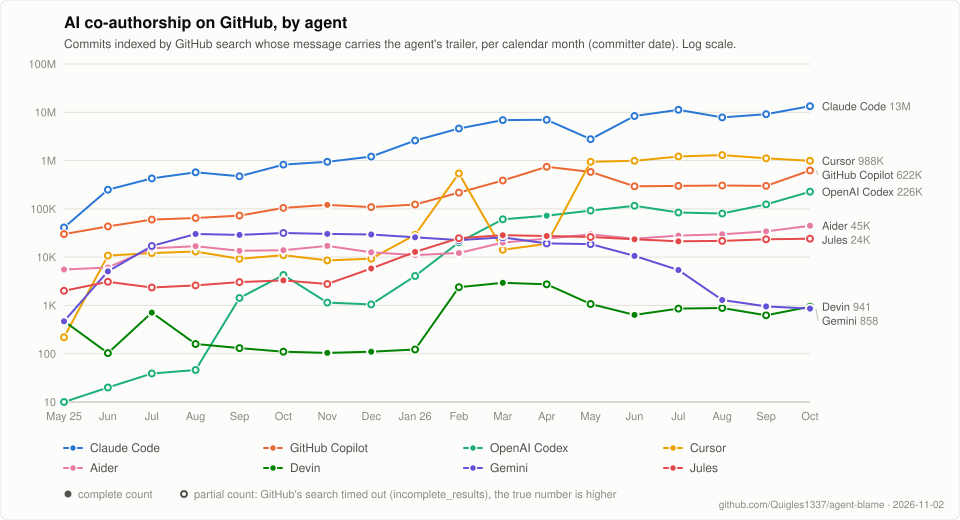

# AI co-authorship on GitHub over time

Generated 2026-11-02 by [`scripts/trends.mjs`](../scripts/trends.mjs); refreshed weekly by [`trends.yml`](../.github/workflows/trends.yml). Raw numbers in [`trends.json`](trends.json).

## Indexed commits per month

Commits indexed by GitHub search whose message matches each agent's query (below), by committer date. † marks a partial count: GitHub's search timed out before scanning everything (`incomplete_results: true`), so the true number is higher by an unknown factor.

| Month | Claude Code | GitHub Copilot | OpenAI Codex | Cursor | Aider | Devin | Gemini | Jules |
| --- | ---: | ---: | ---: | ---: | ---: | ---: | ---: | ---: |
| 2025-05 | 41,192† | 30,059† | 10† | 219† | 5,554 | 474† | 470 | 2,011† |
| 2025-06 | 249,234† | 43,404† | 20† | 10,761† | 6,098 | 103† | 5,075 | 3,093† |
| 2025-07 | 426,340† | 60,001† | 39† | 12,127† | 15,224 | 710 | 16,994† | 2,355† |
| 2025-08 | 572,390† | 64,685† | 46† | 13,079† | 16,871 | 159† | 30,079 | 2,603† |
| 2025-09 | 472,361† | 72,404† | 1,428† | 9,243† | 13,513 | 131† | 28,885 | 3,045† |
| 2025-10 | 826,416† | 104,639† | 4,276† | 10,947† | 13,947 | 110† | 31,648† | 3,303 |
| 2025-11 | 943,579† | 120,958 | 1,147† | 8,551† | 17,122 | 104 | 30,229 | 2,779† |
| 2025-12 | 1,211,019† | 108,555† | 1,052† | 9,303† | 12,581 | 110 | 29,389 | 5,828 |
| 2026-01 | 2,601,939† | 122,953† | 4,071† | 28,999† | 11,004 | 122† | 25,821 | 12,819 |
| 2026-02 | 4,620,794† | 216,907† | 20,297† | 541,155† | 12,212 | 2,386† | 22,578† | 24,621† |
| 2026-03 | 6,900,436† | 386,817† | 60,731† | 14,217† | 19,960 | 2,937 | 25,668† | 28,509 |
| 2026-04 | 6,975,772† | 744,681† | 72,020 | 18,919† | 24,258 | 2,738† | 19,213† | 27,392 |
| 2026-05 | 2,773,615† | 583,340† | 92,047† | 942,386† | 29,525 | 1,071† | 18,582† | 26,156† |
| 2026-06 | 8,393,537† | 293,781† | 115,606† | 991,204† | 24,106 | 637 | 10,622 | 23,363 |
| 2026-07 | 11,238,689† | 298,634† | 84,028† | 1,216,054† | 27,919 | 858† | 5,418 | 21,282 |
| 2026-08 | 7,825,662† | 304,071† | 80,194† | 1,296,651† | 29,767 | 886† | 1,296 | 21,695† |
| 2026-09 | 9,133,899† | 299,192† | 123,838† | 1,116,128† | 34,138 | 626† | 954 | 23,381† |
| 2026-10 | 13,391,866† | 621,818† | 226,206† | 987,692† | 44,726 | 941† | 858 | 24,093† |
| 2026-10 vs 2026-09 | +47% | +108% | +83% | -12% | +31% | +50% | -10% | +3.0% |

## Queries

One commit-search query per agent and month, `<query> committer-date:<first day>..<last day>`; the number is the API's `total_count`. The same table is exported as `AGENT_QUERIES` from `scripts/trends.mjs` and quoted in the README.

| Agent | id | Query |
| --- | --- | --- |
| Claude Code | `claude` | `"Co-authored-by: Claude"` |
| GitHub Copilot | `copilot` | `"Co-authored-by: Copilot"` |
| OpenAI Codex | `codex` | `"Co-authored-by: Codex"` |
| Cursor | `cursor` | `"Co-authored-by: Cursor"` |
| Aider | `aider` | `"(aider)"` |
| Devin | `devin` | `"Co-authored-by: devin-ai-integration"` |
| Gemini | `gemini` | `"Co-authored-by: gemini-code-assist"` |
| Jules | `jules` | `"Co-authored-by: google-labs-jules"` |

## Methodology and caveats

- Source: the GitHub REST commit search API (`GET /search/commits`), which indexes commits on the default branch of repositories GitHub has indexed; forks and other branches are not counted, and private repositories are invisible.
- A commit counts for an agent when its message matches the agent's query as a phrase. Trailers are voluntary and some workflows strip them, so every number is a lower bound on the agent's real activity, and the queries do not cover agents that commit under their own author identity without a trailer.
- Windows are calendar months by committer date (`committer-date:YYYY-MM-01..YYYY-MM-DD`), oldest to newest; the current, incomplete month is left out. Each number is the API's `total_count`, which is not capped at 1,000 (values in the millions are returned).
- GitHub limits the time a search may take. When a query exceeds it the response carries `incomplete_results: true` and `total_count` is only what was found before the cut-off; such cells are marked † and understate the truth by an unknown factor. Every `"Co-authored-by: ..."` phrase query observed so far times out, whatever the result size (the phrase is scanned across the whole index), while the single-token `"(aider)"` query completes. The weekly-split calibration below measures the gap for the latest month.
- Partial counts of the same query vary from run to run by tens of percent, so month-over-month changes of the † series should be read as noise unless they are large.
- Requests are paced (30 s apart, slower after a secondary rate limit; 20 s apart already trips GitHub's secondary limit for these queries) and retried with back-off on 403/429, using the Retry-After header when GitHub sends one.

## Calibration: 2026-10 split into weeks

Whether `total_count` can be trusted is checked each run: the latest month is re-counted as the sum of 7-day windows for every agent whose monthly query was flagged incomplete. A weekly sum far above the monthly figure shows how much the monthly search was cut short; a complete weekly window (no †) is exact as far as the index goes.

| Agent | Monthly total_count | Sum of weekly windows | Weekly windows flagged incomplete |
| --- | ---: | ---: | ---: |
| Claude Code | 13,391,866† | 26,789,231 | 5 of 5 |
| GitHub Copilot | 621,818† | 755,602 | 5 of 5 |
| OpenAI Codex | 226,206† | 299,886 | 5 of 5 |
| Cursor | 987,692† | 1,067,893 | 5 of 5 |
| Devin | 941† | 942 | 4 of 5 |
| Jules | 24,093† | 24,055 | 0 of 5 |

175 search requests, 1 retries, 1 secondary-limit pauses; pace 40 s.
