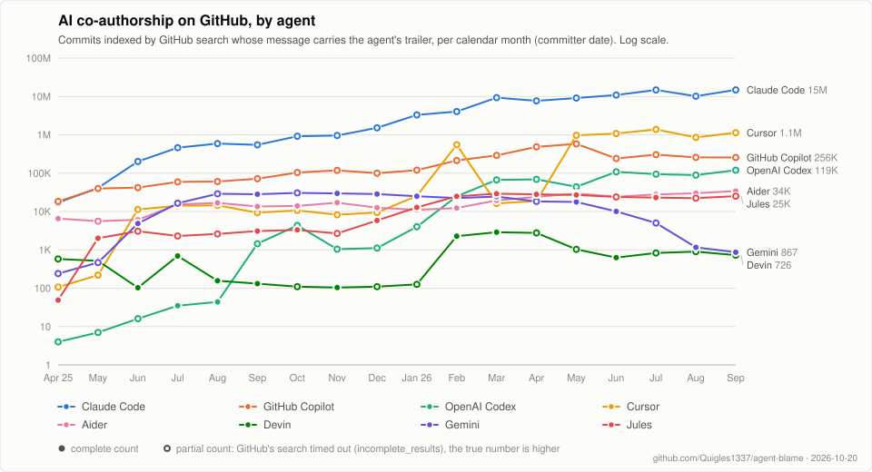

# AI co-authorship on GitHub over time

Generated 2026-10-20 by [`scripts/trends.mjs`](../scripts/trends.mjs); refreshed weekly by [`trends.yml`](../.github/workflows/trends.yml). Raw numbers in [`trends.json`](trends.json).

## Indexed commits per month

Commits indexed by GitHub search whose message matches each agent's query (below), by committer date. † marks a partial count: GitHub's search timed out before scanning everything (`incomplete_results: true`), so the true number is higher by an unknown factor.

| Month | Claude Code | GitHub Copilot | OpenAI Codex | Cursor | Aider | Devin | Gemini | Jules |
| --- | ---: | ---: | ---: | ---: | ---: | ---: | ---: | ---: |
| 2025-04 | 17,075† | 18,306† | 4† | 107† | 6,551 | 579† | 240† | 49 |
| 2025-05 | 41,246† | 39,645† | 7† | 219† | 5,573† | 516 | 466† | 1,999 |
| 2025-06 | 200,929† | 41,927† | 16† | 11,303† | 6,080 | 103 | 4,861 | 3,071† |
| 2025-07 | 461,985† | 58,971† | 35 | 14,184† | 15,179 | 691 | 16,424† | 2,300† |
| 2025-08 | 588,254† | 60,558† | 44 | 14,395† | 16,791 | 156 | 28,949† | 2,605† |
| 2025-09 | 545,349† | 71,512† | 1,442† | 9,309† | 13,523 | 131 | 28,147 | 3,079 |
| 2025-10 | 915,332† | 103,394† | 4,310† | 10,667† | 13,911 | 110† | 30,534† | 3,303 |
| 2025-11 | 954,737† | 117,786† | 1,039† | 8,212† | 16,984 | 104 | 29,566 | 2,671† |
| 2025-12 | 1,519,908† | 99,831† | 1,111† | 9,408† | 12,597 | 110† | 28,548 | 5,822 |
| 2026-01 | 3,307,526† | 119,509† | 3,996† | 25,407† | 11,014 | 126† | 24,946 | 12,797 |
| 2026-02 | 4,029,180† | 214,059† | 24,780 | 549,719† | 12,319 | 2,272 | 22,344 | 24,875 |
| 2026-03 | 9,270,610† | 290,633† | 66,691† | 16,251† | 19,452 | 2,885 | 24,465 | 29,179 |
| 2026-04 | 7,663,268† | 484,446† | 68,733† | 18,742† | 24,072 | 2,758† | 18,330† | 28,014 |
| 2026-05 | 9,071,474† | 579,662† | 43,915† | 965,394† | 29,486 | 1,029† | 17,717 | 27,015 |
| 2026-06 | 10,900,552† | 240,977† | 108,074† | 1,076,868† | 24,157 | 629 | 10,050 | 23,911† |
| 2026-07 | 14,772,428† | 302,787† | 94,072† | 1,381,517† | 27,884 | 828† | 5,009† | 23,084 |
| 2026-08 | 10,140,051† | 257,794† | 88,982† | 853,111† | 29,851 | 899† | 1,161 | 22,308† |
| 2026-09 | 14,863,775† | 256,193† | 119,158† | 1,136,403† | 34,083 | 726† | 867 | 25,094† |
| 2026-09 vs 2026-08 | +47% | -0.6% | +34% | +33% | +14% | -19% | -25% | +12% |

## Queries

One commit-search query per agent and month, `<query> committer-date:<first day>..<last day>`; the number is the API's `total_count`. The same table is exported as `AGENT_QUERIES` from `scripts/trends.mjs` and quoted in the README.

| Agent | id | Query |
| --- | --- | --- |
| Claude Code | `claude` | `"Co-authored-by: Claude"` |
| GitHub Copilot | `copilot` | `"Co-authored-by: Copilot"` |
| OpenAI Codex | `codex` | `"Co-authored-by: Codex"` |
| Cursor | `cursor` | `"Co-authored-by: Cursor"` |
| Aider | `aider` | `"(aider)"` |
| Devin | `devin` | `"Co-authored-by: devin-ai-integration"` |
| Gemini | `gemini` | `"Co-authored-by: gemini-code-assist"` |
| Jules | `jules` | `"Co-authored-by: google-labs-jules"` |

## Methodology and caveats

- Source: the GitHub REST commit search API (`GET /search/commits`), which indexes commits on the default branch of repositories GitHub has indexed; forks and other branches are not counted, and private repositories are invisible.
- A commit counts for an agent when its message matches the agent's query as a phrase. Trailers are voluntary and some workflows strip them, so every number is a lower bound on the agent's real activity, and the queries do not cover agents that commit under their own author identity without a trailer.
- Windows are calendar months by committer date (`committer-date:YYYY-MM-01..YYYY-MM-DD`), oldest to newest; the current, incomplete month is left out. Each number is the API's `total_count`, which is not capped at 1,000 (values in the millions are returned).
- GitHub limits the time a search may take. When a query exceeds it the response carries `incomplete_results: true` and `total_count` is only what was found before the cut-off; such cells are marked † and understate the truth by an unknown factor. Every `"Co-authored-by: ..."` phrase query observed so far times out, whatever the result size (the phrase is scanned across the whole index), while the single-token `"(aider)"` query completes. The weekly-split calibration below measures the gap for the latest month.
- Partial counts of the same query vary from run to run by tens of percent, so month-over-month changes of the † series should be read as noise unless they are large.
- Requests are paced (30 s apart, slower after a secondary rate limit; 20 s apart already trips GitHub's secondary limit for these queries) and retried with back-off on 403/429, using the Retry-After header when GitHub sends one.

## Calibration: 2026-09 split into weeks

Whether `total_count` can be trusted is checked each run: the latest month is re-counted as the sum of 7-day windows for every agent whose monthly query was flagged incomplete. A weekly sum far above the monthly figure shows how much the monthly search was cut short; a complete weekly window (no †) is exact as far as the index goes.

| Agent | Monthly total_count | Sum of weekly windows | Weekly windows flagged incomplete |
| --- | ---: | ---: | ---: |
| Claude Code | 14,863,775† | 19,198,647 | 5 of 5 |
| GitHub Copilot | 256,193† | 357,438 | 5 of 5 |
| OpenAI Codex | 119,158† | 128,298 | 5 of 5 |
| Cursor | 1,136,403† | 1,338,427 | 5 of 5 |
| Devin | 726† | 728 | 2 of 5 |
| Jules | 25,094† | 25,094 | 0 of 5 |

175 search requests, 1 retries, 1 secondary-limit pauses; pace 40 s.
